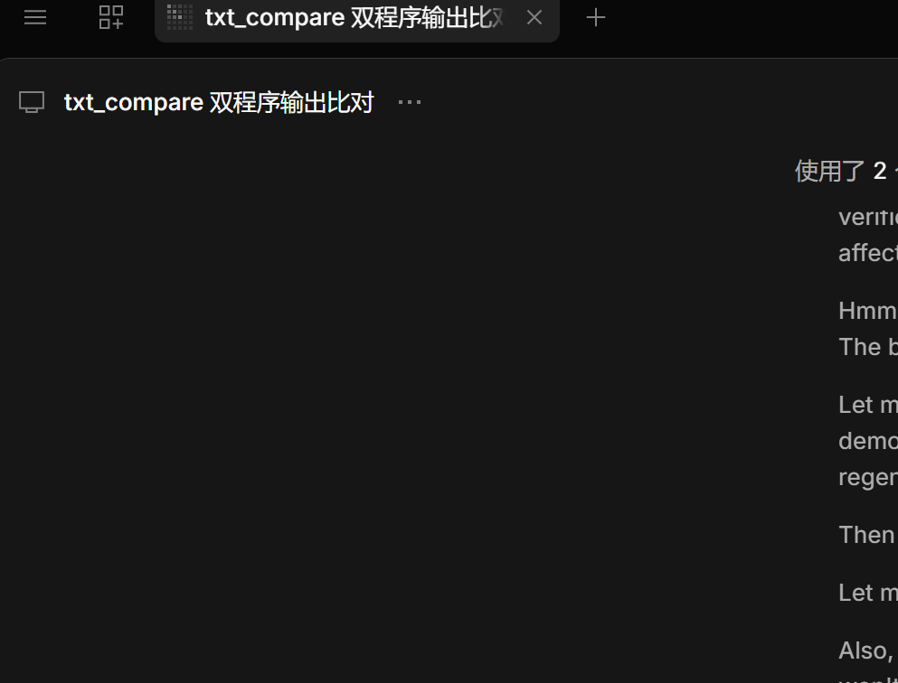

# Output Compare GUI

A small Windows GUI that runs two console programs over a list of test cases,
compares their output with `txt_compare`, and pauses the moment something differs.

No more hand-typing `program.exe < input.txt > out.txt` and
`txt_compare --file1 ... --file2 ...` for every single case.



> The UI is in Chinese; this document is in English.

---

## 1. Features

- Reads a dataset file where **one line = one test case**, and feeds each line to
  both programs as standard input.
- Compares the two outputs immediately, case by case, using `txt_compare`.
- **Auto-pauses** on an output difference, a timeout, or a crash, and prints the
  detailed diff.
- Progress bar, per-case timing, and a scrollable log.
- Saves every input/output/diff to `%TEMP%\gui_compare_out\case_NN\`.
- Single-file Win32 / C++17. No Qt, no MFC, no .NET. Builds with MSVC or MinGW.

---

## 2. Requirements

- Windows 7 SP1 or later (x64).
- `txt_compare.exe` — a third-party command-line comparison tool.
  **It is not included in this repository.**
  - If it sits in `vendor\` at build time, it is embedded into `gui_compare.exe`.
  - If not, the program finds it at run time: next to `gui_compare.exe`, or the
    path you picked once before, or it asks you to pick it (see section 7).

---

## 3. Quick start

1. **DEMO program** — the reference program with the correct output (`.exe`).
2. **My program** — the program you want to test (`.exe`).
3. **Test data** — a text file, one test case per line (see section 4).
4. Click **开始测试** (Start).

The log fills in as each case finishes:

```
[01/32] input: 9999999999.99  -> PASS (47 ms)
[02/32] input: 9999999999.90  -> DIFF (51 ms)
    compare output:
    ...
```

On the first difference the run pauses automatically and the full diff is
written to the log. Then you can:

- **继续** (Resume) — continue with the next case;
- **停止** (Stop) — end this run.

---

## 4. Test data format

**One line = one test case.** Each line is passed verbatim to the programs' stdin.

- Blank lines are ignored.
- Lines starting with `#` are treated as comments.
- A trailing `\r` is stripped; everything else is kept as-is.
- UTF-8, GBK, and UTF-16 (with BOM) files are supported.

Example (`examples/sample-cases.txt`):

```
9999999999.99
9999999999.90
9999999999.09
9900000000
...
```

> Because one line is one case, a case cannot contain a newline. If a program
> needs several lines of input, put them on a single line.

---

## 5. Options

### Ignore whitespace

Maps to `txt_compare --trim`. It only affects **leading/trailing** spaces and tabs
on each line; spaces in the middle of a line always count.

| UI | Flag | Effect |
| --- | --- | --- |
| 不忽略 | `--trim none` | exact match (default) |
| 忽略行首空格 | `--trim left` | strip leading whitespace |
| 忽略行尾空格 | `--trim right` | strip trailing whitespace |
| 忽略首尾空格 | `--trim all` | strip both ends |

**Most common trap:** a trailing space at the end of every output line is
invisible to the eye but makes `txt_compare` report a difference. Pick
“忽略首尾空格” (ignore leading/trailing whitespace) and it goes away.

### Other options

| UI | Flag | Effect |
| --- | --- | --- |
| 跳过前 N 行 | `--lineskip N` | skip the first N lines of both files |
| 忽略空行 | `--ignore_blank` | ignore blank lines |
| 忽略换行符差异 | `--ignore_linefeed` | treat CRLF / LF / CR as equal |
| 超时 | (this tool) | kill a program after N milliseconds |

If your prompts differ from the reference program's prompts, set
“跳过前 N 行” to 1 and only the result lines are compared.

---

## 6. Output files

Everything for each case is written to:

```
%TEMP%\gui_compare_out\case_01\
    in_demo.txt
    in_mine.txt
    out_demo.txt
    out_mine.txt
    compare.txt
```

The folder is cleared at the start of every run. The **打开输出目录** button opens it.

---

## 7. Where `txt_compare.exe` comes from

`txt_compare` is a separate third-party console tool that compares two text files
line by line. This GUI only wraps it. The arguments it uses are:

```
txt_compare.exe --file1 <a> --file2 <b> --display detailed
                [--trim none|left|right|all]
                [--lineskip N] [--ignore_blank] [--ignore_linefeed]
```

Exit code `0` means the files match, `1` means they differ.

Because the tool is not part of this project, you need to obtain a copy yourself
and either:

- put it in `vendor\txt_compare.exe` before building (it gets embedded, ~4 MB exe), or
- put it next to `gui_compare.exe` (it is used in place, ~3 MB exe), or
- do nothing and let the program ask you for it the first time you press Start.

The full lookup order at run time is:

1. **embedded resource** — extracted to `%TEMP%\gui_compare_tmp\<pid>\txt_compare.exe`
   and deleted on exit, so nothing is left on the machine;
2. **`txt_compare.exe` next to `gui_compare.exe`** — used in place, never deleted;
3. **the path remembered in `gui_compare.ini`** (`Tool=`), if that file still exists;
4. otherwise a dialog asks you to pick `txt_compare.exe` once, and the choice is
   saved so you are only asked once.

Cancelling the dialog leaves the run untouched — the status bar says
`已取消：没有 txt_compare，无法比较。`

---

## 8. Build

Single-file pure Win32 (C++17). `vendor\txt_compare.exe` is **optional**.

### MinGW / GCC

```bat
build-gcc.bat
```

The script uses `g++` from `PATH`, then falls back to the RedPanda-C++ default
install location (`%APPDATA%\RedPanda-CPP\mingw64\bin`).

Manual build:

```bat
windres app.rc -O coff -o app_res.o
g++ -std=c++17 -O2 -DUNICODE -D_UNICODE -finput-charset=UTF-8 ^
    gui_compare.cpp app_res.o -o gui_compare.exe ^
    -mwindows -static -static-libgcc -static-libstdc++ -pthread ^
    -lcomctl32 -lcomdlg32 -lshell32 -lole32
```

Add `-DEMBED_TXT_COMPARE` to `windres` to embed the tool.

### MSVC

```bat
build-msvc.bat
```

The script locates Visual Studio with `vswhere` and calls `vcvars64.bat`.

Manual build (from an “x64 Native Tools Command Prompt”):

```bat
rc /nologo /fo app_res.res app.rc
cl /nologo /utf-8 /std:c++17 /EHsc /O2 /DUNICODE /D_UNICODE gui_compare.cpp app_res.res ^
   /Fe:gui_compare.exe /link /SUBSYSTEM:WINDOWS ^
   user32.lib gdi32.lib comctl32.lib comdlg32.lib shell32.lib ole32.lib
```

Add `/d EMBED_TXT_COMPARE` to `rc` to embed the tool.

### Making a release

Build **without** `vendor\txt_compare.exe` and publish that binary: it contains
only this project's code. Do not publish a build that embeds `txt_compare.exe`
unless you have the right to redistribute that tool.

---

## 9. Notes and limitations

1. **The tested programs must read stdin and write stdout.** `cin` / `scanf` /
   `getline` are fine; `_getch()` / `getch()` read the console directly and will
   not see redirected input.
2. **Comparison is byte-exact.** If the two programs emit different encodings
   (GBK vs UTF-8), identical-looking Chinese text is reported as different.
   Build both programs with the same execution charset.
3. **Prompts count as output.** Use “跳过前 N 行” if they differ.
4. **Timeout** defaults to 3000 ms; a program stuck in a loop is killed and the
   run pauses instead of freezing the UI.
5. Settings are stored in `gui_compare.ini` next to the exe (including the
   `txt_compare` path, if you ever had to pick one).

---

## 10. License

The code in this repository is released under the **MIT License** — see
[LICENSE](LICENSE).

`txt_compare.exe` is a third-party binary. It is **not** covered by this license,
is not distributed with this repository, and is not embedded in any release
built from it.
